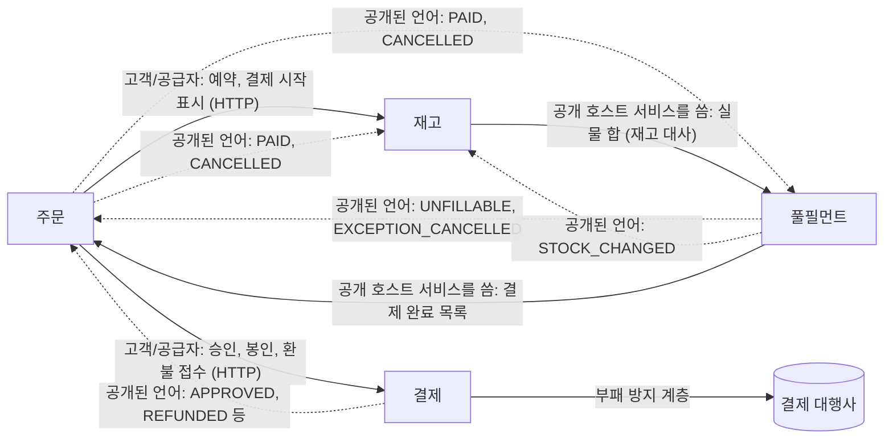

# 07. 도메인 설계

## 요약

**무엇을 설명하나:** 01번부터 05번까지 정한 경계와 규칙을 DDD 의 틀로 다시 묶습니다.
전략적 설계(하위 도메인, Bounded Context, Context Map)와 전술적 설계(애그리게이트와 불변식), 그리고 이 둘을 코드에 어떻게 옮겼는지를 다룹니다.

**세 줄 요약**
1. 핵심 하위 도메인은 재고 예약, 결제 결과의 수렴, 마감 출고 할당이고, 결제 대행사 연동과 메시징은 지원과 일반 하위 도메인입니다.
2. 주문, 재고, 결제, 풀필먼트 네 Bounded Context 는 같은 말을 다른 뜻으로 씁니다. 회차, 재고, 취소가 대표적이라 용어집으로 나눕니다.
3. 애그리게이트는 클래스가 아니라 "한 트랜잭션에서 한 행의 잠금이 지키는 불변식"으로 정했고, 애그리게이트 사이는 이벤트와 수렴 책임 표로 맞춥니다.

---

## 하위 도메인

> 이 회사가 경쟁에서 이기려면 무엇을 잘해야 하는지로 나눕니다. 설계에 공을 들인 곳이 핵심 하위 도메인입니다.

| 구분 | 하위 도메인 | 왜 그렇게 보나 |
|---|---|---|
| 핵심 | 재고 예약 | 특가에 초당 500건이 몰려도 실물보다 많이 팔지 않는 것이 신뢰를 정합니다 |
| 핵심 | 주문과 결제 결과의 수렴 | 결과를 모르는 결제를 돈이 새지 않게 끝까지 마무리합니다 |
| 핵심 | 마감 출고 할당 | 23:00 마감 뒤 01:00 까지 30만 주문을 센터에 나눕니다. 새벽배송의 약속 자체입니다 |
| 지원 | 결제 대행사 연동 | 회차, 멱등키, 미결 조회로 외부의 불확실성을 흡수합니다. 남다른 기능은 아니지만 직접 만들어야 합니다 |
| 일반 | 이벤트 전달(아웃박스, 처리 실패 토픽), 운영 지표 | 어느 회사나 같은 문제입니다. 공용 모듈 하나로 둡니다 |
| 일반 | 상품, 회원, 알림 | 이 설계의 쟁점이 아니라 만들지 않습니다. 필요한 값은 요청에 실려 온다고 둡니다 |

---

## Bounded Context

> 모델이 한 뜻으로 통하는 경계입니다. 네 서비스가 곧 네 경계이고, DB 도 경계마다 따로입니다.

| 경계 | 책임 | 가진 데이터 | 경계 안에서만 통하는 말 |
|---|---|---|---|
| 주문 | 주문 상태 전이와 보상의 유일한 주인 | 주문, 품목, 결제 시도, 환불 요청 | 결제 시도, 결제 회차 번호, 쓰이지 않은 승인 |
| 재고 | 판매 가능 재고와 예약 | 재고, 슬롯, 예약, 부족분, 재고 대사 | 예약 상태(HELD, PAYING), 슬롯, 부족분 |
| 결제 | 외부 대행사와의 경계 | 결제 회차, 환불, 정산 어긋남 | 회차 봉인, 미결(REQUESTED, UNKNOWN), 멱등키 |
| 풀필먼트 | 마감 뒤 출고 | 센터 실물 재고, 출고 대상, 할당, 출고 지시, 출고 예외 | 마감 회차, 대기 수량, 출고 예외, 이월 |

**같은 말이 경계마다 다른 뜻입니다.** 섞이면 설계 토론이 어긋납니다.

| 말 | 주문, 결제에서 | 재고에서 | 풀필먼트에서 |
|---|---|---|---|
| 회차 | 결제 회차. 한 주문의 결제 시도 번호 | 예약에 적힌 결제 회차 | 마감 회차. 23:00 마다 하나 |
| 재고 | 쓰지 않음 | 판매 가능 재고. 전국 합산 | 센터 실물 재고. 센터마다 |
| 취소 | 품목 취소 수량과 환불 | 예약 수량을 되돌리는 복원 | 품목의 취소 수량. 다섯 수량 중 하나 |
| 확정 | PAID | 예약 CONFIRMED | 출고 지시 |

---

## Context Map

> 경계 사이의 관계입니다. 누가 계약을 정하고(상류), 누가 따르는지(하류), 어떤 방식으로 잇는지를 봅니다.

실선은 동기 호출(화살표가 부르는 방향), 점선은 이벤트(화살표가 흐르는 방향)입니다.

| 관계 | 상류 | 하류 | 이유와 계약 위치 |
|---|---|---|---|
| 고객/공급자 | 재고, 결제 | 주문 | 사용자가 기다리는 동기 구간이라 주문이 필요한 것을 공급자가 맞춰 줍니다. 계약은 각 서비스의 HTTP API |
| 부패 방지 계층 | 결제 대행사 | 결제 | 대행사의 응답(타임아웃, 5xx, 요청 없음)을 승인, 거절, 모름 세 가지로 바꿔 안으로 들입니다. 대행사가 바뀌어도 이 층만 고칩니다 |
| 공개된 언어 | 이벤트를 내는 쪽 | 받는 쪽 | 이벤트 형식을 `common-event` 모듈 하나에 둡니다. 아이디는 사실에서 만들어 받는 쪽이 중복을 거릅니다 |
| 공개 호스트 서비스 | 주문, 풀필먼트 | 풀필먼트, 재고 | 결제 완료 목록과 실물 합은 이벤트가 밀려도 원천을 대조하려고 여는 조회입니다 |

**공개된 언어를 공유 라이브러리로 둔 대가.** `common-event` 는 모든 서비스가 같은 판을 씁니다.
필드를 지우거나 뜻을 바꾸면 모든 서비스를 함께 배포해야 해서, 필드는 더하기만 하고 받는 쪽은 모르는 필드를 무시합니다.
경계가 다른 팀으로 갈리면 이벤트 스키마 저장소로 옮길 지점입니다.

---

## 애그리게이트와 불변식

> 한 트랜잭션 안에서 반드시 지켜야 하는 규칙의 경계가 애그리게이트입니다. 이 설계는 그 경계를 "어느 행을 잠그는가"로 정했습니다.

| 경계 | 애그리게이트 (루트 행) | 지키는 불변식 | 지키는 방법 |
|---|---|---|---|
| 주문 | 주문 (`orders` 행, 품목 포함) | 결제 시도는 한 번에 하나. 시도를 끝내는 갱신은 그 회차만. 품목 취소 수량은 주문 수량을 넘지 않음 | 시도 상태와 회차를 조건으로 건 갱신. 품목 취소는 주문 행을 잠근 뒤 |
| 주문 | 환불 요청 (`refund_request` 행) | 같은 사유의 환불은 한 번. 누적액은 완료로 바뀐 1행일 때만 더함 | 사유에서 만든 환불 키의 유니크, 상태 조건 갱신 |
| 재고 | 재고 (`stock` 행, 슬롯 포함) | 판매 가능 재고는 0 아래로 내려가지 않음. 부족분이 0보다 크면 판매 가능 재고는 0 | 조건부 차감, 늘리는 쪽은 부족분부터 갚음 |
| 재고 | 예약 (주문과 상품마다 한 행) | 만료 전에만 결제 시작. 결제가 시작된 예약은 회차를 봉인한 뒤에만 풂 | HELD 를 조건으로 한 결제 시작과 만료, 회차 조건 되돌림 |
| 결제 | 주문별 결제 (`payment_order` 행, 회차와 환불 포함) | 가장 최근 회차가 FAILED 나 EXPIRED 일 때만 새 회차. 봉인된 회차는 열리지 않음. 환불 합은 승인 금액 이하 | 이 행을 먼저 잠그고 검사, `(주문번호, 회차)` 유니크 |
| 풀필먼트 | 출고 대상 (주문마다, 품목 포함) | 품목의 다섯 수량(대기, 출고, 못 채움, 예외, 취소) 합은 주문 수량 | 옮길 쪽 수량을 조건으로 건 이동, 표의 CHECK 제약 |
| 풀필먼트 | 마감 회차 (`cutoff_run` 행) | 스텝은 한 방향으로만 진행. 같은 마감 시각은 한 번만 완료 | 이전 단계를 조건으로 건 갱신, 잡 파라미터 |
| 풀필먼트 | 출고 예외 | 이월과 관리자 취소 중 한쪽만 | OPEN 조건 갱신 |

**애그리게이트 사이는 한 트랜잭션으로 묶지 않습니다.** 주문이 PAID 가 되는 것과 예약이 CONFIRMED 가 되는 것은 다른 트랜잭션, 다른 DB 입니다.
그 사이의 어긋남은 01번 "수렴 책임" 표가 주인과 기한을 정해 맞춥니다. 이것이 이 설계에서 결과적 일관성이 뜻하는 바입니다.

---

## 코드에 옮긴 방식

> 애그리게이트를 풍부한 도메인 객체로 만들지 않고, 불변식을 SQL 조건으로 지키는 트랜잭션 스크립트로 옮겼습니다.

| 경계 | 모듈 | 패키지 (역할) |
|---|---|---|
| 주문 | `order-service` | `placement`(동기 흐름), `recovery`(정리 배치, 결제 이벤트), `cancel`, `refund`, `store` |
| 재고 | `inventory-service` | `stock`(차감, 슬롯, 부족분), `reservation`, `reconciliation`, `consumer` |
| 결제 | `payment-service` | `round`(회차와 봉인), `pg`(부패 방지 계층), `guard`(동시 호출 한도, 회로 차단기), `refund`, `settlement` |
| 풀필먼트 | `fulfillment-batch` | `target`, `allocation`, `unfillable`, `shipment`, `verification`, `admin`, `stock` |
| 공개된 언어 | `common-event` | 이벤트 레코드와 토픽 이름 |
| 일반 하위 도메인 | `messaging` | 아웃박스, 릴레이, 처리 실패 토픽, 보존 정리, 공통 지표 |

**왜 도메인 객체가 아닌가.** 이 설계의 불변식은 대부분 "동시에 와도 하나만 이긴다"입니다.
객체에 상태를 읽어 와 판단하고 저장하면, 읽은 뒤 저장하기 전에 다른 요청이 끼어드는 갱신 유실이 생깁니다(02번 "문제를 정확히 세우기").
그래서 판단을 `UPDATE ... WHERE 이전 상태` 한 문장에 넣고, 영향받은 행 수로 이겼는지를 압니다.

**대가.** 규칙이 SQL 문자열에 흩어져, 한 애그리게이트의 규칙을 한눈에 보기 어렵습니다.
그래서 한 애그리게이트의 전이는 저장소 클래스 하나에 모으고(예: 주문 행의 전이는 `OrderRepository`), 규칙마다 경합 테스트를 둡니다.
계산만 하는 규칙은 순수한 도메인 서비스로 뺐습니다. 출고 할당의 `Allocator` 는 DB 없이 입력만으로 결과를 내고, 단위 테스트로 결정성을 지킵니다.

**바꿀 지점.** 경합이 없는데 규칙이 많은 곳이 생기면 그곳부터 도메인 객체로 옮깁니다.
예를 들어 쿠폰과 할인 계산이 주문서 검증에 들어오면, 계산은 객체로 하고 저장만 조건부 갱신으로 합니다.

---

## 용어집

| 용어 | 뜻 | 경계 |
|---|---|---|
| 주문서 ID | 주문서 화면을 열 때 받는 값. 같은 주문 요청의 재시도를 한 주문으로 묶음 | 주문 |
| 결제 시도 | 주문 행의 IDLE, IN_PROGRESS. 주문당 한 번에 하나 | 주문 |
| 결제 회차 | 한 주문의 몇 번째 결제인지. 멱등키 `order-{주문번호}-payment-{회차}` 를 만듦 | 주문, 결제 |
| 봉인 | 아직 열리지 않은 회차에 EXPIRED 행을 넣어 늦게 온 승인 요청이 열지 못하게 함 | 결제 |
| 미결 | 결과를 모르는 결제. REQUESTED 는 조회 배치가, UNKNOWN 은 사람이 확정 | 결제 |
| 쓰이지 않은 승인 | 주문을 PAID 로 만들지 못한 회차의 승인. 주문 서비스가 환불 | 주문 |
| 예약 | 결제 전에 잡아 둔 판매 가능 재고. HELD, PAYING, CONFIRMED, RELEASED, RESTORED | 재고 |
| 슬롯 | 특가 상품의 재고를 나눠 담은 여덟 행 | 재고 |
| 부족분 | 실사로 줄여야 했지만 0 아래라 줄이지 못한 수량. 늘리는 쪽이 먼저 갚음 | 재고 |
| 재고 대사 | 판매 가능 재고와 센터 실물이 식으로 맞는지 하루 한 번 확인 | 재고 |
| 마감 회차 | `paid_at` 이 전 마감 뒤이고 이번 마감 이하인 주문들 | 풀필먼트 |
| 대기 수량 | 다음 할당을 기다리는 품목 수량. 할당의 유일한 입력 | 풀필먼트 |
| 출고 예외 | 출고 지시를 만들지 못한 (센터, 주문). 사람이 이월하거나 취소 | 풀필먼트 |
| 이월 | 출고 예외의 수량을 다음 회차의 대기 수량으로 돌림 | 풀필먼트 |
| 수렴 | 늦게 확정되는 상태를 주인이 기한 안에 끝내는 것 (01번 "수렴 책임") | 전체 |
