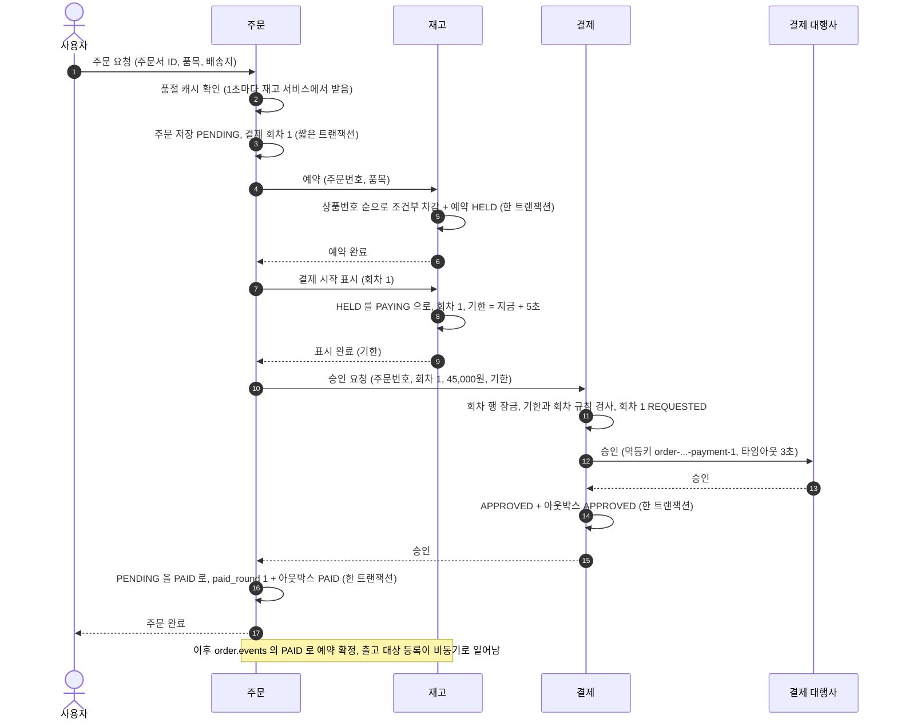
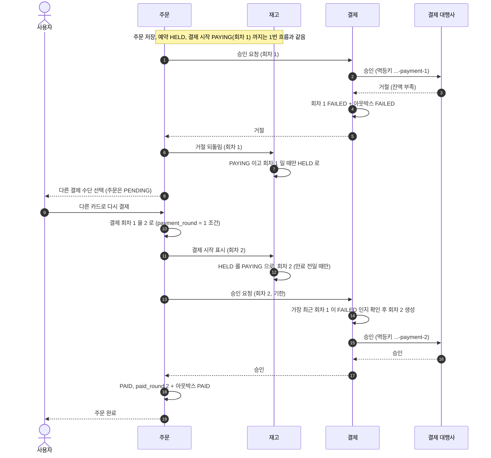
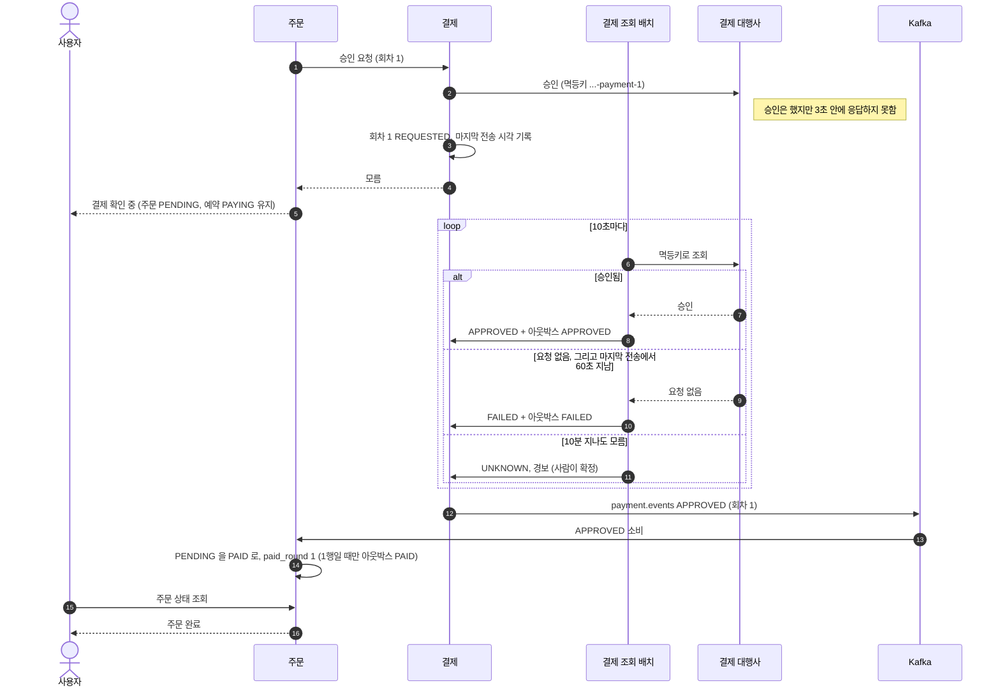
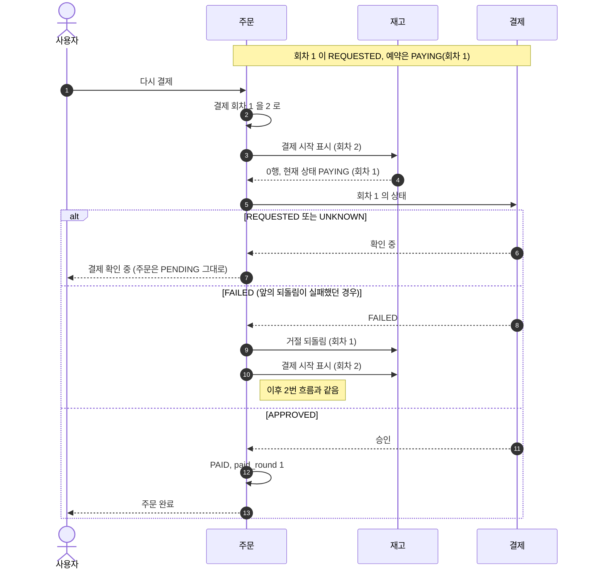
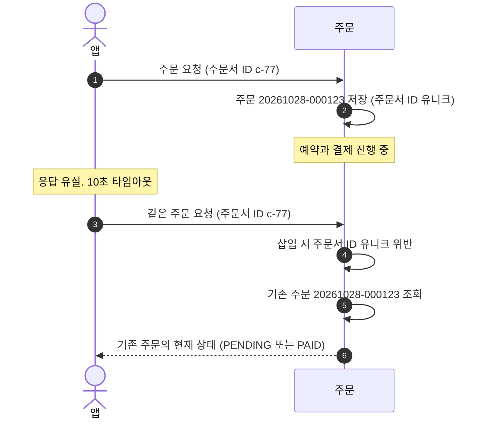
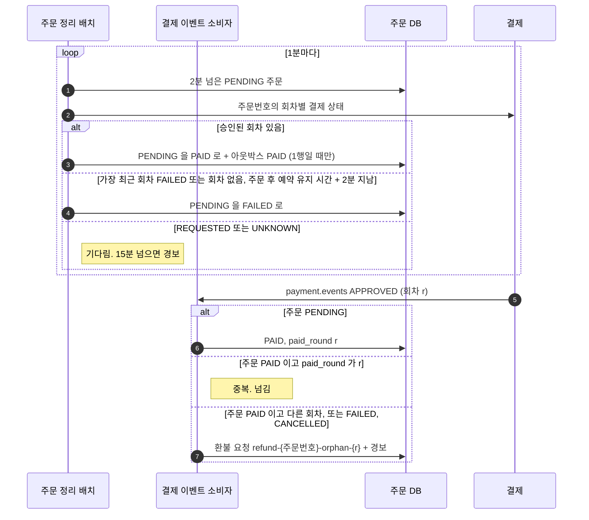

# 01. 주문과 결제

주문 요청부터 결제 결과가 주문에 반영되기까지의 흐름입니다. 설계 근거는 [01 전체 설계](../design/01-전체-설계.md)와 [04 멱등성과 실패 복구](../design/04-멱등성과-실패-복구.md)에 있습니다.

| 흐름 | 언제 |
|---|---|
| [1. 결제 승인](#1-결제-승인) | 대행사가 바로 승인할 때 |
| [2. 카드 거절과 다시 결제하기](#2-카드-거절과-다시-결제하기) | 잔액 부족 같은 거절 뒤 다른 카드로 결제할 때 |
| [3. 결과를 모를 때](#3-결과를-모를-때) | 대행사 타임아웃이나 응답 유실 |
| [4. 결제 확인 중에 다시 누를 때](#4-결제-확인-중에-다시-누를-때) | 앞 결제의 결과를 모르는데 사용자가 결제를 또 누를 때 |
| [5. 주문 요청 중복](#5-주문-요청-중복) | 앱이 응답을 못 받고 같은 주문을 다시 보낼 때 |
| [6. 주문 정리 배치와 쓰이지 않은 승인](#6-주문-정리-배치와-쓰이지-않은-승인) | 결제 결과가 주문에 반영되지 않았거나, 주문이 쓰지 않은 승인이 왔을 때 |

---

## 1. 결제 승인

사용자가 기다리는 구간입니다. 외부 호출은 모두 트랜잭션 밖에서 하고, 짧은 트랜잭션만 주문 DB 커넥션을 씁니다.

- **8번:** 바뀐 예약 행 수가 품목 수와 다르면 결제를 부르지 않습니다
- **11번:** 기한이 지난 요청이면 회차를 열지 않습니다. 만료 배치가 "회차 없음"을 믿을 수 있게 하는 장치입니다
- **16번:** `status = 'PENDING'` 조건부 갱신이 1행일 때만 아웃박스를 씁니다

---

## 2. 카드 거절과 다시 결제하기

거절은 결과가 확실한 실패라 주문을 실패시키지 않고, 예약을 유지한 채 다음 회차를 받습니다.

- **7번:** 회차 조건이 있어서, 늦게 도착한 회차 1의 되돌림이 회차 2의 PAYING 을 HELD 로 바꾸지 않습니다
- **10번:** 다시 결제를 두 번 눌러도 회차 조건 때문에 한 요청만 다음 회차로 갑니다
- 예약 유지 시간이 지나면 12번이 RELEASED 를 만나 결제를 부르지 않고 실패로 답합니다

---

## 3. 결과를 모를 때

타임아웃은 실패가 아니라 모르는 상태입니다. 사용자에게는 "결제 확인 중"으로 답하고, 결제 서비스가 뒤에서 확정해 이벤트로 알립니다.

- **조회는 멱등키로 합니다.** 주문번호로 조회하면 2회차 승인을 1회차 결과로 잘못 읽을 수 있습니다
- **"요청 없음"은 마지막 전송에서 60초가 지난 뒤에만 믿습니다.** 다시 보낸 요청이 처리 중일 수 있습니다

---

## 4. 결제 확인 중에 다시 누를 때

결제 시작 표시가 0행이면 예약의 현재 상태로 나눕니다. 0행을 "예약이 풀렸다"로만 보면, 돈은 빠졌는데 주문은 실패로 남습니다.

예약이 RELEASED 일 때만 주문을 FAILED 로 닫습니다. 만료로 풀렸다면 결제 기한도 지나 새 회차가 열릴 수 없습니다.

---

## 5. 주문 요청 중복

결제 멱등키는 주문번호로 만드는데, 주문번호는 서버가 요청마다 만듭니다. 그래서 주문 요청 자체를 주문서 ID 로 묶습니다.

두 번째 요청은 새 주문을 만들지 않으므로 결제도 다시 나가지 않습니다.

---

## 6. 주문 정리 배치와 쓰이지 않은 승인

정리 배치는 결제 이벤트를 놓쳤거나, 승인 응답을 받은 직후 PAID 를 커밋하기 전에 주문 서비스가 죽은 경우를 잡습니다.
결제 이벤트 소비자는 주문이 쓰지 않은 승인을 환불합니다.

마지막 갈래는 설계대로면 생기지 않습니다. 대행사가 실패로 닫은 회차를 아주 늦게 승인한 경우에 대비한 안전망입니다.
