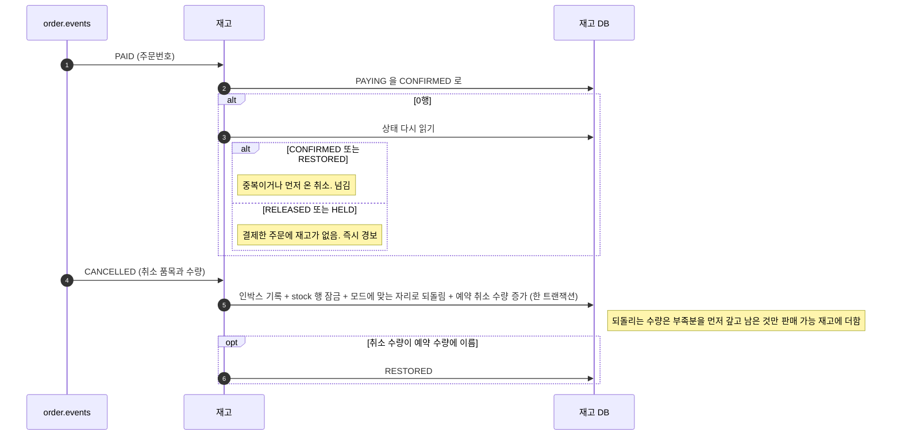
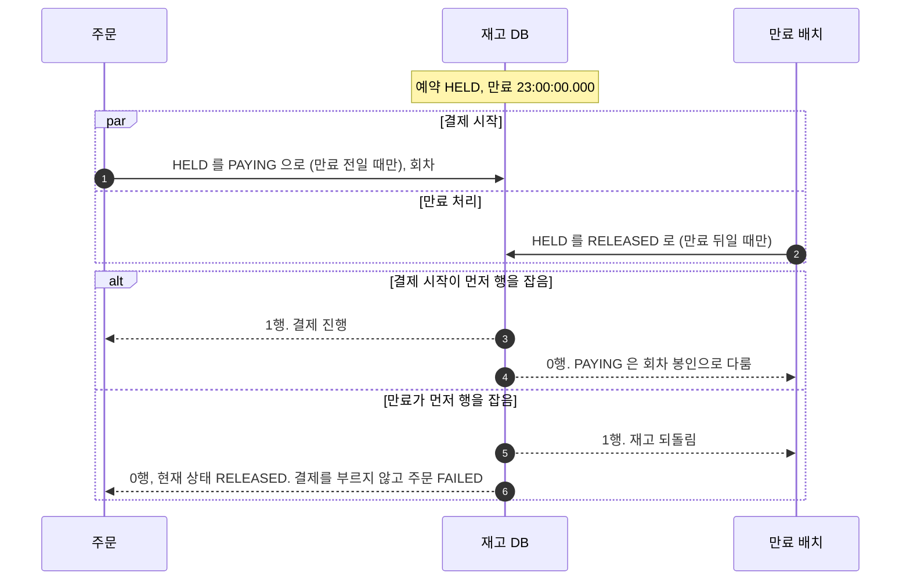
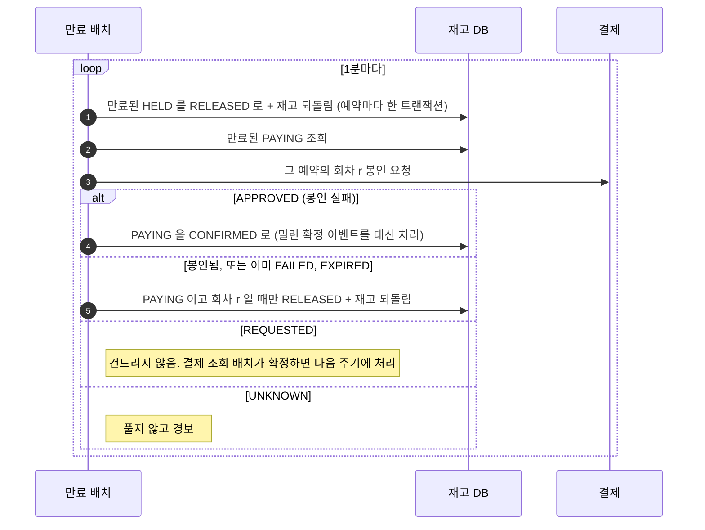
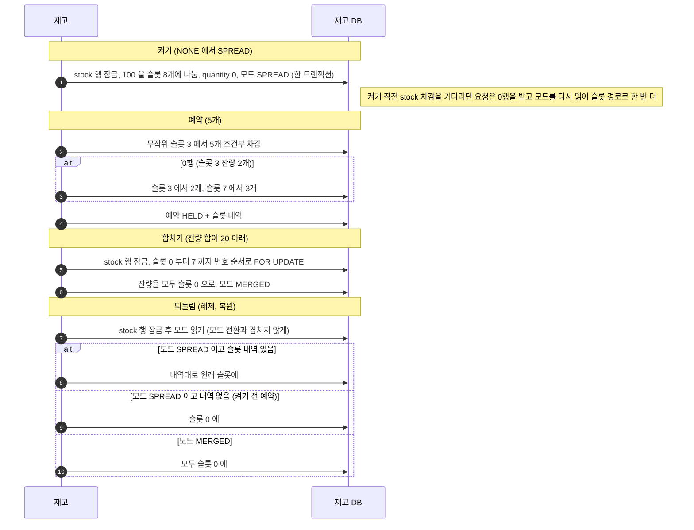
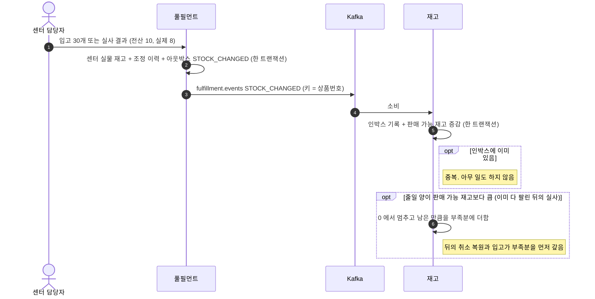

# 02. 재고

예약의 확정과 복원, 만료, 특가 상품의 슬롯, 입고와 실사 반영 흐름입니다. 설계 근거는 [02 재고 정합성](../design/02-재고-정합성.md)에 있습니다.

| 흐름 | 언제 |
|---|---|
| [1. 예약 확정과 복원](#1-예약-확정과-복원) | PAID 나 CANCELLED 가 도착할 때 |
| [2. 결제 시작과 만료가 겹칠 때](#2-결제-시작과-만료가-겹칠-때) | 만료 직전에 사용자가 결제를 누를 때 |
| [3. 예약 만료 배치](#3-예약-만료-배치) | 만료 시각이 지난 예약을 정리할 때 |
| [4. 특가 상품 슬롯](#4-특가-상품-슬롯) | 슬롯을 켜고, 차감하고, 합치고, 해제할 때 |
| [5. 입고와 실사](#5-입고와-실사) | 센터 실물 재고가 바뀔 때 |

---

## 1. 예약 확정과 복원

취소 사유(고객, 출고 불가, 관리자)와 관계없이 같은 규칙입니다. 실사로 반영하지 못한 부족분이 먼저 갚아지므로 없는 재고를 되살리지 않습니다.
예약이 아직 PAYING 이어도 복원합니다. PAID 처리가 처리 실패 토픽으로 빠진 사이 취소가 먼저 오는 경우입니다.

---

## 2. 결제 시작과 만료가 겹칠 때

두 갱신이 모두 `status = 'HELD'` 를 조건으로 걸어서, 같은 순간에 와도 하나만 성공합니다.

---

## 3. 예약 만료 배치

HELD 는 결제가 시작되지 않았다는 뜻이라 바로 풉니다. PAYING 은 그 회차를 봉인한 뒤에만 풉니다.

봉인은 `(주문번호, 회차)` 유니크 자리에 EXPIRED 행을 넣는 것이라, 늦게 온 승인 요청은 그 회차를 열지 못합니다.
시간 가정 없이 먼저 커밋한 쪽만 이깁니다. 만료 5분이 지나도 남은 HELD, PAYING 은 경보를 냅니다.

---

## 4. 특가 상품 슬롯

한 행의 상한(초당 200건)을 넘는 상품만 재고를 슬롯 8개로 나눕니다. 모드에 따라 해제할 자리가 다릅니다.

- **번호 순서로 잠그는 이유:** 두 합치기가 엇갈린 순서로 잠그면 교착이 납니다
- **되돌림도 stock 행을 잠그는 이유:** SPREAD 를 읽고 슬롯 3에 되돌리는 사이 합치기가 MERGED 로 바꾸면, 슬롯 3의 재고는 팔리지 않습니다
- **MERGED 뒤에 슬롯 0 으로 되돌리는 이유:** 합친 뒤에는 슬롯 0 에서만 팔아서, 다른 슬롯에 되돌린 재고는 팔리지 않습니다

---

## 5. 입고와 실사

실물 재고는 풀필먼트가 바꾸고, 판매 가능 재고는 이벤트를 받은 재고 서비스가 바꿉니다.

