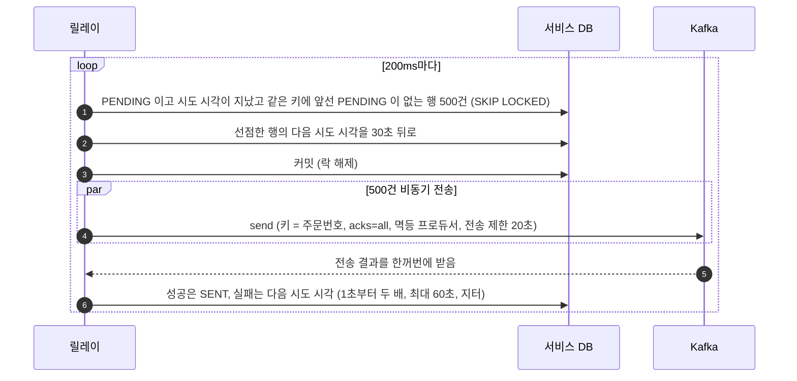
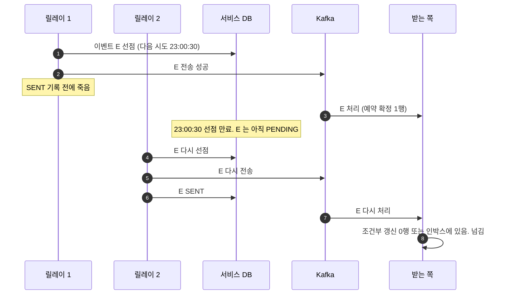
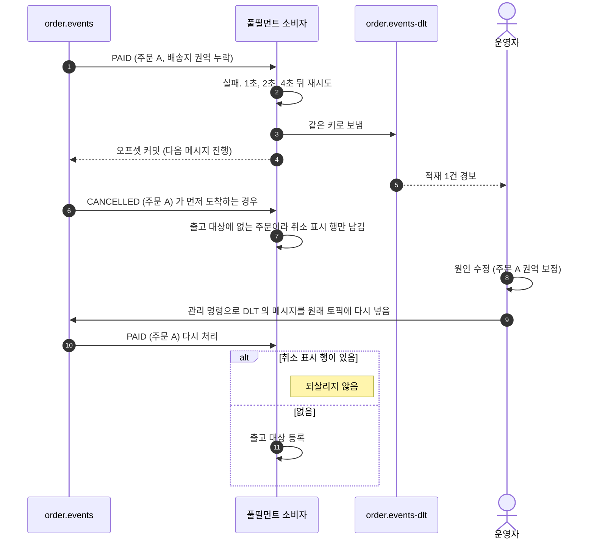

# 03. 이벤트 전달

아웃박스 릴레이가 이벤트를 보내는 흐름과, 받는 쪽이 처리하지 못한 메시지를 다루는 흐름입니다. 설계 근거는 [03 이벤트 전달 보장](../design/03-이벤트-전달-보장.md)에 있습니다.

| 흐름 | 언제 |
|---|---|
| [1. 아웃박스 릴레이](#1-아웃박스-릴레이) | 주문, 결제, 풀필먼트가 이벤트를 발행할 때 |
| [2. 릴레이가 중간에 죽을 때](#2-릴레이가-중간에-죽을-때) | 전송 뒤 기록 전에 릴레이가 죽을 때 |
| [3. 처리 실패 토픽](#3-처리-실패-토픽) | 받는 쪽이 재시도해도 처리하지 못할 때 |

---

## 1. 아웃박스 릴레이

락을 쥔 채 Kafka 를 기다리지 않도록 선점, 전송, 기록을 나눕니다.

- **같은 키에 앞선 PENDING 이 있으면 뒤의 것을 집지 않습니다.** 앞선 것이 다시 시도를 기다리는 동안 뒤의 것이 앞질러 나가지 않습니다
- **릴레이가 여러 대여도 됩니다.** SKIP LOCKED 로 서로 다른 행을 집고, 선점 표시가 다음 주기의 중복 선택을 막습니다
- **10번 넘게 실패하면 경보를 내고 계속 시도합니다.** 버리는 상태는 없습니다
- **전송 제한 시간(20초)이 선점(30초)보다 짧습니다.** 늦게 끝난 전송이 다른 릴레이의 재전송과 겹치지 않습니다

---

## 2. 릴레이가 중간에 죽을 때

보낸 뒤 기록 전에 죽으면 같은 이벤트가 다시 나갑니다. 최소 한 번 전달의 성질이고 받는 쪽이 막습니다.

이벤트 아이디는 사실(주문번호와 사건)에서 만들어서, 다시 나간 E 도 같은 아이디입니다. 인박스가 중복을 거를 수 있습니다.

---

## 3. 처리 실패 토픽

재시도해도 실패하는 메시지를 로그만 남기고 넘기면 그 주문은 조용히 사라집니다. 처리 실패 토픽에 남기고 사람이 다시 넣습니다.

운영자가 다시 넣지 못한 채 마감이 오더라도, 출고 배치의 대상 확정 스텝이 주문 서비스 목록과 대조해 주문 A 를 채웁니다.
