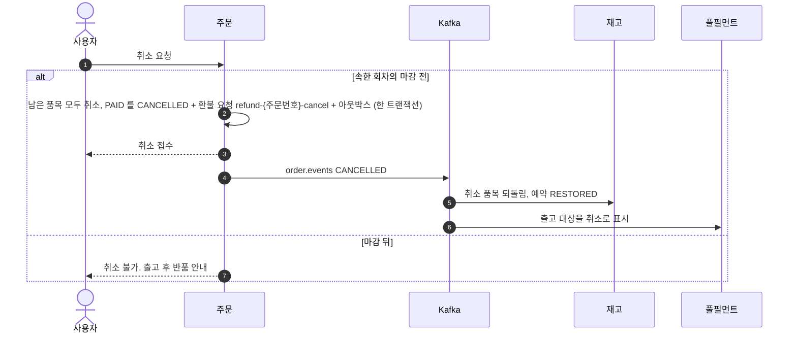
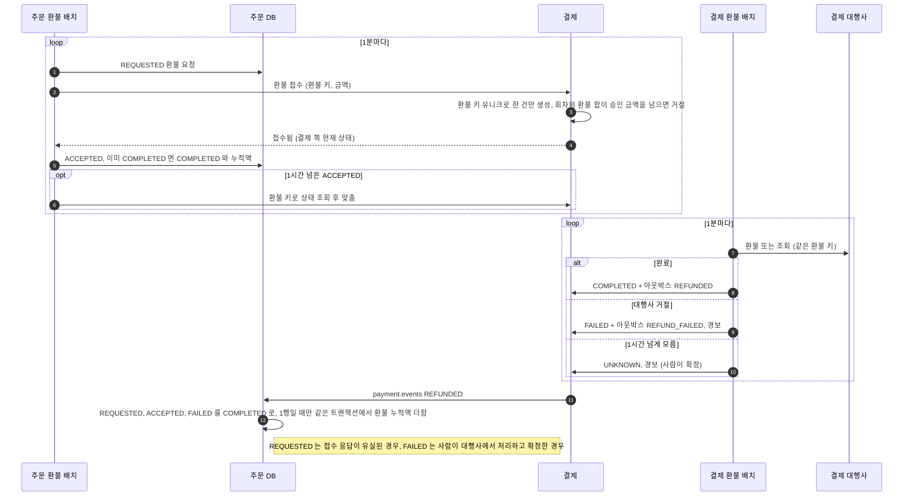
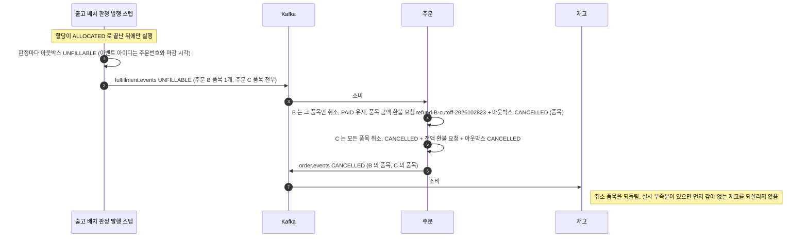
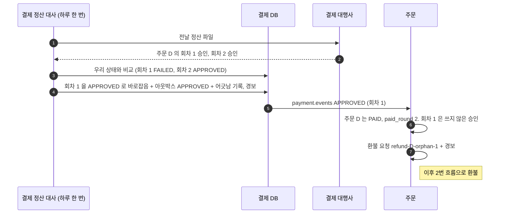

# 04. 취소와 환불

고객 취소, 환불 처리, 출고 불가 환불, 늦은 승인의 환불 흐름입니다. 환불을 만드는 쪽은 언제나 주문 서비스입니다. 설계 근거는 [04 멱등성과 실패 복구](../design/04-멱등성과-실패-복구.md)와 [05 풀필먼트와 배치](../design/05-풀필먼트-배치.md)에 있습니다.

| 흐름 | 언제 |
|---|---|
| [1. 고객 취소](#1-고객-취소) | 주문이 속한 회차의 마감 전에 고객이 취소할 때 |
| [2. 환불 처리](#2-환불-처리) | 환불 요청을 접수시키고 대행사와 확정할 때 |
| [3. 출고 불가 환불](#3-출고-불가-환불) | 할당에서 못 채운 품목으로 판정될 때 |
| [4. 늦은 승인의 환불](#4-늦은-승인의-환불) | 실패로 닫은 회차를 대행사가 늦게 승인했을 때 |

---

## 1. 고객 취소

마감 뒤 고객 취소를 받지 않기 때문에, 출고 배치가 대상을 확정한 뒤 대상이 바뀌는 길은 사람이 처리하는 출고 예외뿐입니다.

---

## 2. 환불 처리

경계는 "결제 서비스가 접수했는가" 입니다. 접수시키는 일은 주문 서비스가, 대행사와 확정하는 일은 결제 서비스가 맡습니다.

"기존 환불 건수 + 1" 로 키를 만들면, 재시작 때 같은 환불에 새 번호가 붙어 두 번 환불됩니다. 키는 사유에서 만듭니다.

---

## 3. 출고 불가 환불

판정은 풀필먼트가 하고, 환불은 주문 서비스가 합니다.

환불 요청이 생긴 뒤는 2번 흐름이 처리합니다. 이벤트가 두 번 와도 환불 키 유니크라 요청은 하나입니다.

---

## 4. 늦은 승인의 환불

새 회차는 앞 회차가 FAILED 나 EXPIRED 일 때만 열리므로 정상이라면 승인이 둘 생기지 않습니다.
그래도 "요청 없음"으로 FAILED 를 확정한 회차를 대행사가 아주 늦게 승인하면 생깁니다. 결제 서비스는 알리기만 하고, 환불은 주문 서비스가 합니다.

FAILED 에서 APPROVED 로 가는 전이는 정산 대사만 할 수 있습니다. 대행사의 정산이 사실이기 때문입니다.
