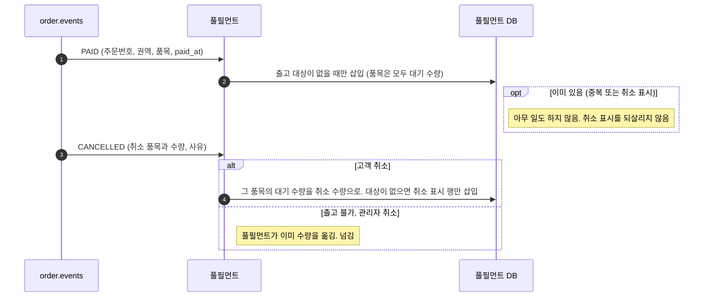
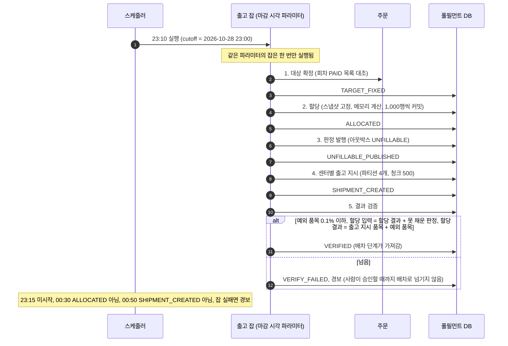
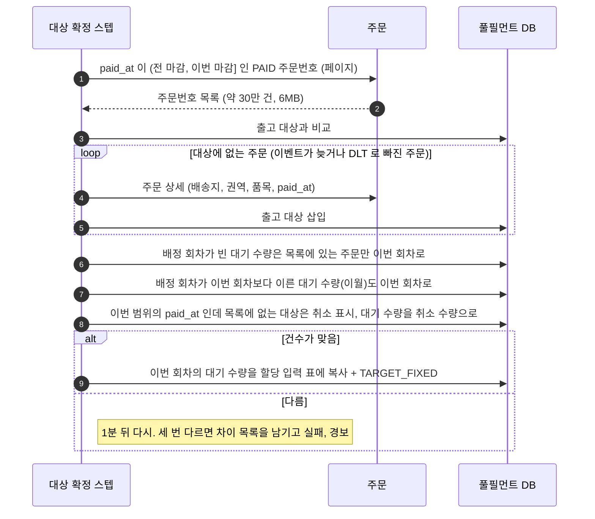
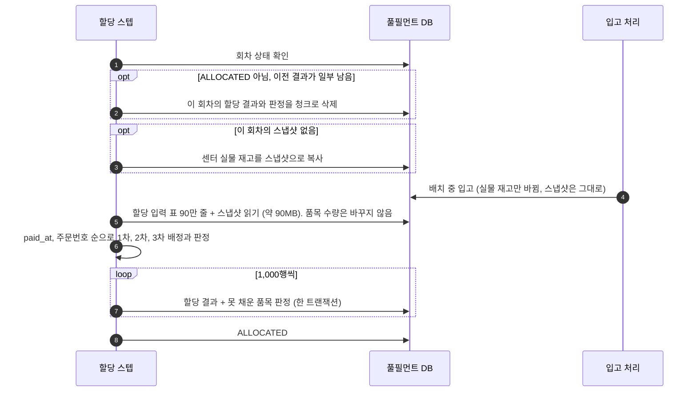
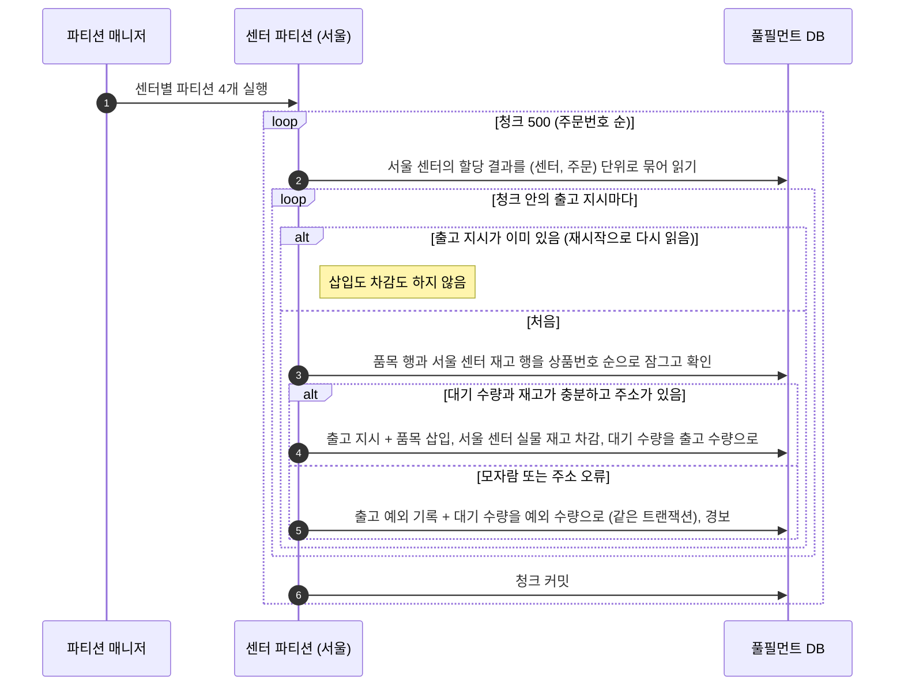
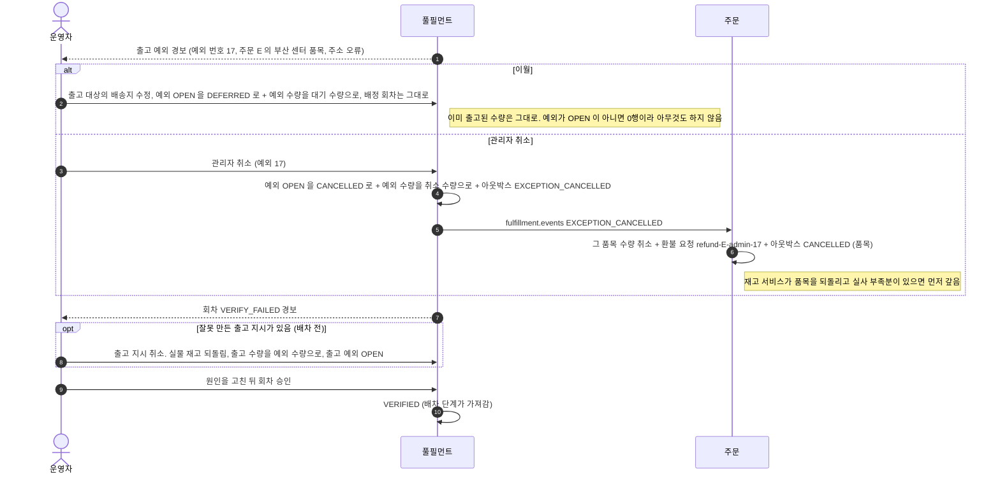

# 05. 출고 배치

마감 뒤 출고 지시를 만드는 배치의 흐름입니다. 대상 확정, 할당, 판정 발행, 센터별 출고 지시, 결과 검증 다섯 스텝으로 나눕니다. 설계 근거는 [05 풀필먼트와 배치](../design/05-풀필먼트-배치.md)에 있습니다.

| 흐름 | 언제 |
|---|---|
| [1. 출고 대상 등록](#1-출고-대상-등록) | 평소. PAID 이벤트가 올 때마다 |
| [2. 전체 흐름](#2-전체-흐름) | 매일 23:10 마감 회차 배치 |
| [3. 대상 확정](#3-대상-확정) | 배치 첫 스텝 |
| [4. 할당과 재시작](#4-할당과-재시작) | 배치 둘째 스텝, 저장 중에 죽었을 때 |
| [5. 센터별 출고 지시](#5-센터별-출고-지시) | 배치 넷째 스텝 |
| [6. 출고 예외와 검증 실패](#6-출고-예외와-검증-실패) | 사람이 처리해야 하는 경우 |

---

## 1. 출고 대상 등록

마감에 한꺼번에 읽지 않으려고 평소에 미리 쌓습니다.

---

## 2. 전체 흐름

---

## 3. 대상 확정

이벤트가 밀리거나 처리 실패 토픽으로 빠진 주문도 원천과 대조해 채웁니다.

22:59:58 에 PAID 가 된 주문의 이벤트가 23:03 에 도착해도, 이 스텝이 주문 서비스 목록에서 찾아 넣습니다.
반대로 23:04 에 PAID 가 된 주문은 23:10 전에 이벤트로 등록돼도 목록에 없어 이번 회차에 오르지 않습니다.

---

## 4. 할당과 재시작

입력 품목과 재고를 모두 고정해, 저장 중간에 죽어 다시 계산해도 같은 결과가 나옵니다. 판정 이벤트는 할당이 끝난 뒤에 냅니다.

배치 중 입고된 재고는 이번 할당에 쓰이지 않고 다음 회차에 쓰입니다. 결과가 바뀌지 않는 대가입니다.

---

## 5. 센터별 출고 지시

센터 4곳으로 나눠 병렬로 돌립니다. 각 파티션은 자기 센터의 실물 재고 행만 차감합니다.

---

## 6. 출고 예외와 검증 실패

결제가 끝난 주문이라 자동으로 환불하지 않고 사람이 고릅니다.

